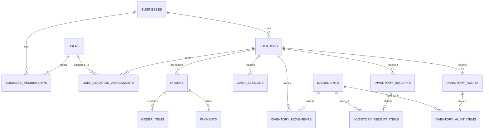

# Ủ LAB BUSINESS OS — ARCHITECTURE
**MVP 01: POS + DOANH THU + KHO**

## 1. Tổng quan kiến trúc
Ủ LAB Business OS MVP 01 tập trung giải quyết 3 bài toán sống còn tại chuỗi cà phê takeaway:
1. **Module A — POS**: Bán hàng nhanh tại quầy, giỏ hàng, tùy biến ly nước, tính tiền backend, in phiếu.
2. **Module B — Doanh thu**: Dashboard theo dõi doanh thu thuần, dòng tiền thực thu, hoàn hủy và chốt ca tiền mặt.
3. **Module C — Quản lý kho**: Danh mục nguyên liệu, phiếu nhập hàng, quản lý tồn, cảnh báo hết hàng, kiểm kê và ghi nhận hao hụt.

---

## 2. Nguyên tắc kiến trúc cốt lõi
1. **Toàn vẹn tiền tệ & Định dạng số nguyên**:
   - Toàn bộ số tiền (doanh thu, đơn giá, giảm giá, tiền khách đưa, tiền thừa, tiền nhập hàng) được lưu trữ bằng số nguyên VND (`BIGINT`).
2. **Idempotency & Chống ghi trùng**:
   - Mọi thao tác thanh toán đơn hàng và lập phiếu nhập/xuất kho đều mang `idempotency_key` duy nhất để ngăn chặn nhân viên ấn đúp hoặc mạng chậm tạo giao dịch trùng lặp.
3. **Multi-tenant & Multi-location từ đầu**:
   - Mọi bảng dữ liệu nghiệp vụ đều sở hữu `business_id` (Doanh nghiệp) và `location_id` (Cửa hàng / Điểm bán).
4. **Phân tách thực thể dữ liệu rõ ràng**:
   - `orders`: Quản lý đơn hàng, mã đơn, kênh, thời gian, trạng thái (`PENDING`, `CONFIRMED`, `CANCELLED`).
   - `order_items`: Snapshot tên món, size, số lượng, đơn giá, ghi chú và tùy chọn tại đúng thời điểm bán.
   - `payments`: Lưu từng giao dịch thanh toán (tiền mặt, chuyển khoản QR), hỗ trợ đối soát độc lập.
   - `cash_sessions`: Phiên mở/đóng ca bán hàng, tiền thối đầu ca, tiền bán, tiền chi khẩn cấp, tiền kiểm đếm thực tế và chênh lệch két.
   - `ingredients`: Danh mục nguyên vật liệu pha chế, đơn vị tính chuẩn (g, ml, kg, lon, hộp...), định mức tồn tối thiểu (`min_stock_level`).
   - `inventory_receipts` & `inventory_receipt_items`: Phiếu nhập hàng từ nhà cung cấp, ngày nhập, đơn giá mua, người nhập.
   - `inventory_movements`: Sổ cái ghi nhận mọi biến động kho (`IN_PURCHASE` nhập mua, `OUT_LOSS` hao hụt/hỏng, `ADJUST_AUDIT` điều chỉnh kiểm kê, `OUT_RECIPE` chuẩn bị cho trừ kho công thức).
   - `inventory_audits` & `inventory_audit_items`: Phiếu kiểm kê thực tế định kỳ, tự động tính chênh lệch thừa/thiếu.
5. **Nguyên tắc kho trong MVP 01**:
   - **Tuyệt đối không tự động trừ kho theo công thức pha chế** trong giai đoạn này khi chưa có module công thức và quy tắc xuất kho được nghiệm thu.
   - Toàn bộ thay đổi tồn kho được kiểm soát qua: Phiếu nhập hàng, Phiếu ghi nhận hao hụt/điều chỉnh, và Phiếu kiểm kê.

---

## 3. Cấu trúc thư mục (`coffee-app/`)
```text
coffee-app/
├── database/
│   ├── schema.sql                                 # Schema cơ sở ban đầu
│   └── migrations/
│       ├── 0001_m01_pos_foundation.sql            # M01: Multi-location & POS Bán hàng
│       ├── 0002_m02_revenue_reconciliation.sql    # M02: Sổ quỹ két tiền mặt & chốt ca
│       └── 0003_m03_inventory_and_payments.sql    # M03: Kho nguyên liệu, phiếu nhập & payments
├── src/
│   ├── app/
│   │   ├── admin/                                 # Giao diện POS, Doanh thu & Quản lý Kho
│   │   └── api/
│   │       ├── pos/
│   │       │   ├── menu/route.ts                  # Lấy menu & cấu hình size/topping
│   │       │   └── orders/
│   │       │       ├── route.ts                   # Tạo đơn POS & tra cứu đơn gần đây
│   │       │       └── [id]/cancel/route.ts       # Hủy đơn theo quyền có audit log
│   │       ├── revenue/
│   │       │   └── summary/route.ts               # Dashboard doanh thu & chốt ca tiền mặt
│   │       └── inventory/
│   │           ├── ingredients/route.ts           # Danh mục nguyên liệu & tồn kho
│   │           ├── receipts/route.ts              # Phiếu nhập hàng
│   │           ├── adjustments/route.ts           # Ghi nhận hao hụt & điều chỉnh tồn
│   │           └── audits/route.ts                # Kiểm kê kho & chênh lệch
│   ├── components/
│   │   └── Admin/
│   │       ├── POSPanel.tsx                       # Module A: POS Bán hàng & In phiếu
│   │       ├── RevenuePanel.tsx                   # Module B: Doanh thu & Đối soát két
│   │       └── InventoryPanel.tsx                 # Module C: Quản lý Kho, Nhập hàng, Hao hụt
│   └── lib/
│       ├── auth-utils.ts                          # Server auth & role checking
│       ├── pos/                                   # Domain logic & repo Module A
│       ├── revenue/                               # Domain logic & repo Module B
│       └── inventory/                             # Domain logic & repo Module C
│           ├── domain.ts                          # Tính toán tồn, giá trị kho, chênh lệch kiểm kê
│           ├── repository.ts                      # Data access Supabase cho kho
│           └── __tests__/
│               └── domain.test.ts                 # Unit tests cho nghiệp vụ kho
```

---

## 4. Mô hình Thực thể Quan hệ (ERD) cho MVP 01


